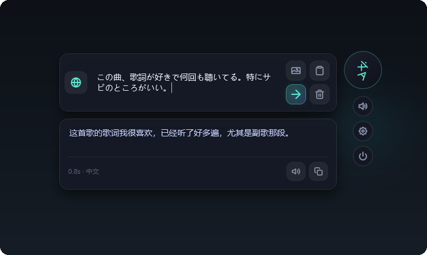

<div align="center">

# Hotaru

**A floating, always-on-top translator for Windows — Japanese first.**

A 64 px orb sits over everything. Click it, type or paste, get a streaming translation
card back. It can also listen to whatever your PC is playing and caption Japanese speech
on screen — and let you click any word to look it up offline.



`Windows 10/11` · `C# / .NET 10 (WPF)` · [中文说明](README.zh-CN.md)

</div>

---

Speech recognition, dictionary lookup and the system voices run locally. Only translation
(and the optional online voice channel) needs a network.

## Features

**Translation**
- Out of the box it talks to [Index-Translate](https://github.com/bilibili/Index-Translate)'s
  free public API (`https://index-translate.bilibili.com/v1`) — no key, no GPU. Any
  OpenAI-compatible endpoint can be swapped in via `api_base`; everything below is identical.
- Streaming output, three model tiers (`Index-Translate` 2B / 9B / 35B-A3B), with optional
  auto-downgrade that retries on the next tier down when a model stalls (12 s to first token).
- 34 target languages, auto source detection, long text split at sentence boundaries.
- Image translation without OCR: pick, drag or `Ctrl+V` a screenshot and the model reads it.
- Glossary, instruction presets, style hint; JSON and code keep their formatting.

**Captions & dictionary (offline, CPU only)**
- Captures what your PC is playing via WASAPI loopback — no microphone permission — and
  transcribes it locally through sherpa-onnx: the default INT8 Parakeet 0.6B Japanese model
  (segment-by-segment), or an optional streaming Zipformer zh/en model with live partials.
- Two-line captions (Japanese above, Chinese below), last 60 lines scrollable.
- Click any word to look it up: conjugated forms are deinflected first; headword, reading,
  part of speech and definitions in a panel next to the cursor.
- Word book: star words from the lookup panel, search and export CSV.

**Voice**
- System voices (SAPI / OneCore), or Edge's neural Read Aloud voices — free, no API key —
  with 8 Chinese and 7 Japanese presets.
- Optional local Irodori-TTS service for Japanese voice cloning and caption-driven design.

**Shell**
- Global hotkeys (`Ctrl+Alt+Q` / `Ctrl+Alt+W`) translate the current selection, falling back
  to the clipboard, without opening the window first.
- History (100 entries), adjustable opacity, optional always-on-top.

## Quick start

1. Windows 10/11 x64 + [.NET 10 Desktop Runtime](https://dotnet.microsoft.com/download).
2. Build (see below) and run `bin\Release\net10.0-windows\悬浮翻译器.exe`. First launch writes
   `悬浮翻译器.config.json` next to it.
3. Set `api_base` and `api_key` in that file, pick a `model`.
4. Type, paste, or `Ctrl+V` a screenshot, then press `Enter`.

Captions and lookup need two extra downloads, both configured in **Settings → 字幕**:

| Component | Used for | Where to get it |
| --- | --- | --- |
| ASR model folder (`model.int8.onnx` + `tokens.txt`) | live captions, default engine | `sherpa-onnx-nemo-parakeet-tdt_ctc-0.6b-ja-35000-int8` (the app can download it) |
| Streaming model folder (`encoder` / `decoder` / `joiner` + `tokens.txt`) | optional live-partial captions | `sherpa-onnx-streaming-zipformer-bilingual-zh-en-2023-02-20` (~510 MB, also downloadable in-app) |
| Yomitan dictionary folder (`term_bank_*.json`) | click-to-lookup | Jitendex, or any Yomitan-format dictionary (also downloadable in-app) |

## Configuration

`悬浮翻译器.config.json` lives next to the exe and is rewritten on every settings change.

| Key | Default | Meaning |
| --- | --- | --- |
| `api_base` | `https://index-translate.bilibili.com/v1` | OpenAI-compatible base URL — the Index-Translate public API by default, point it at your own endpoint if you prefer |
| `api_key` | *(empty)* | bearer token; leave empty if not needed |
| `model` | `Index-Translate-35B-A3B` | model id |
| `model_fallback` / `model_fallback_timeout` | `true` / `12` | downgrade when no first token arrives in time |
| `source` / `target` | `auto` / `zh` | language codes |
| `chunk_limit` | `700` | characters per chunk for long text |
| `instruction` / `genre` / `glossary` | *(empty)* | prompt controls |
| `asr_engine` | `offline` | `offline` = Parakeet JA (original); `streaming` = Zipformer zh/en with live partials |
| `asr_model_dir` / `asr_stream_model_dir` | *(empty)* | local model folders for the two engines |
| `dict_dir` | *(empty)* | local path for the dictionary |
| `speak_engine` | `system` | `system` voices or `edge` (online, neural) |
| `hotkey_toggle` / `hotkey_select` | `Ctrl+Alt+Q` / `Ctrl+Alt+W` | empty string = don't register |

## Shortcuts

| Key | Action |
| --- | --- |
| `Enter` | translate |
| `Shift+Enter` | newline in the input box |
| `Ctrl+V` | screenshot → image translation, otherwise paste |
| `Esc` | cancel translation; then close dropdown / settings / dictionary / captions |
| `Ctrl+Alt+Q` / `Ctrl+Alt+W` | translate the selection (or the clipboard) |

## Build

```bash
git clone https://github.com/<you>/hotaru.git
cd hotaru
dotnet build -c Release
```

The `sherpa-onnx` 1.13.8 binaries in `第三方/sherpa-onnx/` (~22 MB) are committed so the
project builds without restoring them. `悬浮翻译器.exe --demo <scene>` boots a scripted
layout scene for visual checks (`wide`, `paste`, `capdict`, `wordbook`, …).

## Project layout

```
MainWindow.xaml(.cs)            overlay shell: orb, cards, drag, layout
MainWindow.Settings.cs          settings panel, history and word book windows
MainWindow.Asr.cs               captions, word hit-testing, dictionary popup
Core/TranslateClient.cs         streaming client + model downgrade
Core/YomitanDictionary.cs       dictionary index + deinflection
Core/SherpaAsr.cs               offline + streaming recognizers
Core/LoopbackCapture.cs         WASAPI loopback capture
Core/EdgeTts.cs, EdgeDrm.cs     Edge Read Aloud synthesis + token derivation
Core/Speaker.cs, IrodoriTts.cs  local voices
Core/AppConfig.cs               config, language list, model tiers
```

## Acknowledgements

| Project | Used for | License |
| --- | --- | --- |
| [Index-Translate](https://github.com/bilibili/Index-Translate) | the translation models, and the free public OpenAI-compatible API (`index-translate.bilibili.com/v1`) the app defaults to | Apache-2.0 |
| [sherpa-onnx](https://github.com/k2-fsa/sherpa-onnx) | offline ASR engine and C# bindings (vendored, with onnxruntime) | Apache-2.0 |
| [NVIDIA Parakeet TDT-CTC 0.6B (Japanese)](https://huggingface.co/nvidia/parakeet-tdt_ctc-0.6b-ja) | the default speech recognition model | CC-BY-4.0 |
| [Streaming Zipformer bilingual zh/en](https://huggingface.co/csukuangfj/sherpa-onnx-streaming-zipformer-bilingual-zh-en-2023-02-20) | the optional streaming recognition model | Apache-2.0 |
| [Jitendex](https://github.com/stephenmk/Jitendex) | dictionary data, derived from JMdict / [EDRDG](https://www.edrdg.org/jmdict/j_jmdict.html) | CC BY-SA 4.0 |
| [Yomitan](https://github.com/yomidevs/yomitan) | the dictionary file format the lookup panel reads | GPL-3.0 (format only) |
| [edge-tts](https://github.com/rany2/edge-tts) | documented the Edge Read Aloud protocol and the `Sec-MS-GEC` derivation this C# port follows | GPL-3.0 |
| [Irodori-TTS](https://huggingface.co/Aratako/Irodori-TTS-v4.1-Small-Quantized) | the Japanese voice model behind the optional local TTS channel | see model card |

No third-party source code is vendored apart from the sherpa-onnx binaries; the Edge TTS
client and the dictionary reader are original implementations written against those
projects' published protocols and file formats.

Translation is the one feature that depends on someone else's service: the default endpoint
is Index-Translate's free public API, so its availability and rate limits are not ours to
control. Point `api_base` at a self-hosted deployment for anything beyond casual use.

## License

MIT — see [LICENSE](LICENSE).
