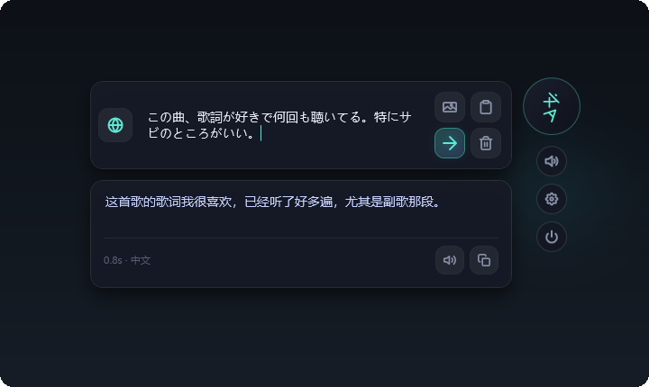

<div align="center">

# Hotaru（萤）

**Windows 上的悬浮翻译器 —— 以日语优先。**

一颗 64px 的圆钮常驻在所有窗口之上。点开、输入或粘贴，译文以流式卡片浮在旁边。
看直播、玩游戏时，它还能听电脑正在播放的声音，把日语字幕实时铺在屏幕底部 ——
点任意一个词，弹出离线词典。



`Windows 10/11` · `C# / .NET 10 (WPF)` · [English](README.md)

</div>

---

语音识别、查词、系统语音都在本地跑；只有翻译（以及可选的在线语音）需要联网。

## 功能

**翻译**
- 默认直接调用 [Index-Translate](https://github.com/bilibili/Index-Translate) 的免费公网 API
  （`https://index-translate.bilibili.com/v1`，不用 Key、不用显卡）；也可以通过 `api_base`
  换成任何 OpenAI 兼容接口，下面这些功能完全一样。
- 三档模型（`Index-Translate` 2B / 9B / 35B-A3B）+ 流式输出；可选「首字超时自动降级」（默认 12 秒无首字就换下一档）。
- 同语言改写（如日语→日语，换成更易懂的说法）；结果卡多一个「中」按钮，点一下在下方加一行中文对照。
- 34 种目标语言、源语言自动检测、长文按句子边界分段。
- **图片翻译（零 OCR）**：选图 / 拖进窗口 / `Ctrl+V` 粘贴截图，模型直接读图。
- 术语表、指令预设、文体声明；JSON 与代码保格式。

**字幕与查词（本地 CPU）**
- 用 WASAPI loopback 捕获电脑正在播放的声音（不需要麦克风权限），本地 `sherpa-onnx` 识别：
  默认 Parakeet 0.6B 日语（INT8，整段解码），可选 Zipformer 中英流式模型（边听边出半句）。
- 字幕两行（上日文 / 下中文），保留最近 60 条可上翻。
- 点任意日语词查词：活用先还原成辞书形，浮层贴着光标显示词形 / 读音 / 词性 / 释义。
- 生词本：浮层里 ☆ 收藏，可搜索、导出 CSV。

**语音**
- 系统语音（SAPI / OneCore），或 Edge 神经语音「大声朗读」（免费、不需要 Key，内置 8 中文 + 7 日语音色）。
- 可选的本地 Irodori-TTS 服务，做日语音色克隆与音色设计。

**外壳**
- 全局热键（`Ctrl+Alt+Q` / `Ctrl+Alt+W`）：翻译选中文本，取不到就用剪贴板，不用先打开窗口。
- 历史记录（100 条）、不透明度可调、可取消置顶。

## 快速开始

1. Windows 10/11 x64 + [.NET 10 桌面运行时](https://dotnet.microsoft.com/download)。
2. 构建（见下）后运行 `bin\Release\net10.0-windows\悬浮翻译器.exe`，首次启动会在旁边生成
   `悬浮翻译器.config.json`。
3. 填 `api_base`、`api_key`，选一个 `model`。
4. 输入 / 粘贴 / `Ctrl+V` 截图，回车。

字幕与查词需要另外下载两份数据，都在 **设置 → 字幕** 里配：

| 需要 | 用途 | 从哪来 |
| --- | --- | --- |
| ASR 模型文件夹（`model.int8.onnx` + `tokens.txt`） | 实时字幕（默认方案） | `sherpa-onnx-nemo-parakeet-tdt_ctc-0.6b-ja-35000-int8`（设置里有下载按钮） |
| 流式模型文件夹（`encoder` / `decoder` / `joiner` + `tokens.txt`） | 可选：边听边出半句 | `sherpa-onnx-streaming-zipformer-bilingual-zh-en-2023-02-20`（约 510 MB，设置里也有下载按钮） |
| Yomitan 词典文件夹（`term_bank_*.json`） | 点词查词 | Jitendex 或任意 Yomitan 格式词典（同样可一键下载） |

## 配置

`悬浮翻译器.config.json` 就在 exe 旁边，改设置即写盘。

| 键 | 默认 | 含义 |
| --- | --- | --- |
| `api_base` | `https://index-translate.bilibili.com/v1` | OpenAI 兼容地址，默认用 Index-Translate 公网 API，想自建就换成自己的 |
| `api_key` | 空 | 不需要鉴权可留空 |
| `model` | `Index-Translate-35B-A3B` | 模型 id |
| `model_fallback` / `model_fallback_timeout` | `true` / `12` | 首字超时自动降级 |
| `source` / `target` | `auto` / `zh` | 语言代码 |
| `chunk_limit` | `700` | 长文分段字数 |
| `instruction` / `genre` / `glossary` | 空 | 指令 / 文体 / 术语表 |
| `asr_engine` | `offline` | `offline` = 原 Parakeet 日语；`streaming` = Zipformer 中英流式 |
| `asr_model_dir` / `asr_stream_model_dir` | 空 | 两套识别模型各自的目录 |
| `dict_dir` | 空 | 词典目录 |
| `speak_engine` | `system` | `system` 系统语音 / `edge` 在线语音 |
| `hotkey_toggle` / `hotkey_select` | `Ctrl+Alt+Q` / `Ctrl+Alt+W` | 留空 = 不注册 |

## 快捷键

| 按键 | 作用 |
| --- | --- |
| `Enter` | 翻译 |
| `Shift+Enter` | 输入框内换行 |
| `Ctrl+V` | 剪贴板是图片 → 图片翻译，否则普通粘贴 |
| `Esc` | 取消翻译；再依次关下拉 / 设置 / 词典 / 字幕 |
| `Ctrl+Alt+Q` / `Ctrl+Alt+W` | 翻译选中文本（或剪贴板） |

## 构建

```bash
git clone https://github.com/<you>/hotaru.git
cd hotaru
dotnet build -c Release
```

`第三方/sherpa-onnx/` 里 vendor 了 sherpa-onnx 1.13.8（约 22 MB），是刻意提交的 ——
这样不需要额外 restore。`悬浮翻译器.exe --demo <场景>` 可直接摆出某个界面场景用于核对
（`wide`、`paste`、`capdict`、`wordbook` 等）。

## 工程结构

```
MainWindow.xaml(.cs)            悬浮外壳：圆钮、卡片、拖拽、布局
MainWindow.Settings.cs          设置面板、历史与生词本窗口
MainWindow.Asr.cs               实时字幕、字幕命中、词典浮层
Core/TranslateClient.cs         流式客户端 + 模型降级
Core/YomitanDictionary.cs       词典索引与活用还原
Core/SherpaAsr.cs               离线 / 流式两种识别封装
Core/LoopbackCapture.cs         WASAPI loopback 采集
Core/EdgeTts.cs, EdgeDrm.cs     Edge 朗读合成与令牌推导
Core/Speaker.cs, IrodoriTts.cs  本地语音
Core/AppConfig.cs               配置、语言表、模型档位
```

## 致谢

| 项目 | 用在哪 | 许可 |
| --- | --- | --- |
| [Index-Translate](https://github.com/bilibili/Index-Translate) | 翻译模型；以及程序默认调用的免费公网 OpenAI 兼容 API（`index-translate.bilibili.com/v1`） | Apache-2.0 |
| [sherpa-onnx](https://github.com/k2-fsa/sherpa-onnx) | 离线语音识别引擎 + C# 绑定（vendor，含 onnxruntime） | Apache-2.0 |
| [NVIDIA Parakeet TDT-CTC 0.6B（日语）](https://huggingface.co/nvidia/parakeet-tdt_ctc-0.6b-ja) | 默认语音识别模型 | CC-BY-4.0 |
| [Streaming Zipformer 中英双语](https://huggingface.co/csukuangfj/sherpa-onnx-streaming-zipformer-bilingual-zh-en-2023-02-20) | 可选的流式识别模型 | Apache-2.0 |
| [Jitendex](https://github.com/stephenmk/Jitendex) | 词典数据（由 JMdict / [EDRDG](https://www.edrdg.org/jmdict/j_jmdict.html) 派生） | CC BY-SA 4.0 |
| [Yomitan](https://github.com/yomidevs/yomitan) | 查词面板读取的词典文件格式 | GPL-3.0（仅格式） |
| [edge-tts](https://github.com/rany2/edge-tts) | 公开了 Edge 朗读协议与 `Sec-MS-GEC` 推导，本项目的 C# 实现参照它 | GPL-3.0 |
| [Irodori-TTS](https://huggingface.co/Aratako/Irodori-TTS-v4.1-Small-Quantized) | 可选本地语音通道使用的日语模型 | 见模型页 |

除 sherpa-onnx 的二进制外，仓库里没有 vendor 其它项目的源码；Edge TTS 客户端与词典读取
都是照这些项目公开的协议与文件格式自己写的实现。

翻译是唯一依赖外部服务的地方：默认走 Index-Translate 的免费公网 API，它的可用性和限流
不由本项目控制；正式使用建议把 `api_base` 指向自建部署。

## 许可

MIT，见 [LICENSE](LICENSE)。
